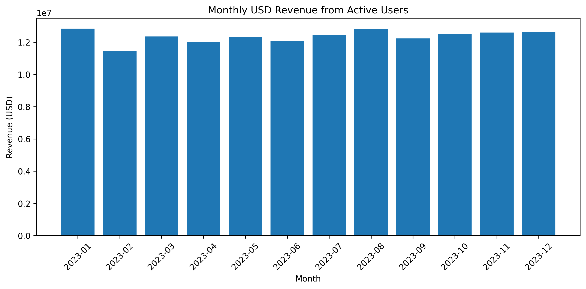
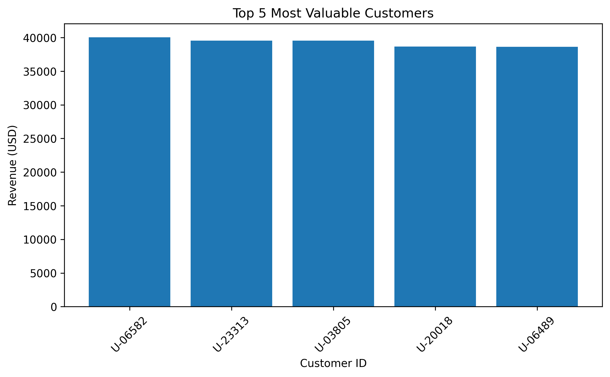
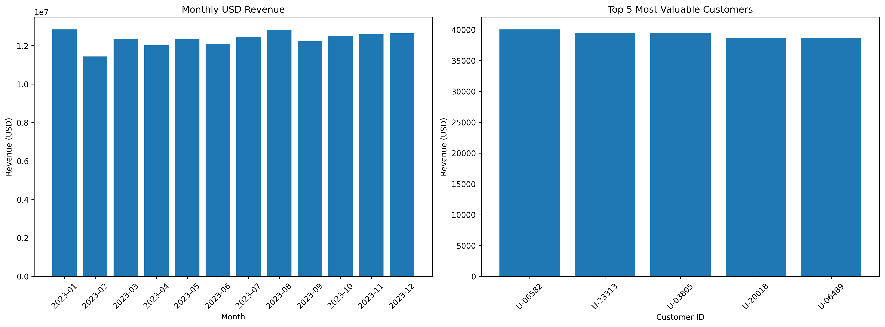

# Project Big Bank — Enterprise Data Reconciliation System

An internship project focused on transaction processing, data quality validation, currency conversion, and revenue analysis using Python, SQL, SQLite, Pandas, and Matplotlib.

## Project Overview

Project Big Bank is an end-to-end data reconciliation project designed to transform raw transaction logs into structured, validated, and analysis-ready data.

The workflow extracts transaction information from server logs, validates records, converts EUR revenue into USD using exchange-rate data, identifies the latest status of users through SQL, and reconciles transactions against active-user records.

The project also generates revenue reports, customer-level analysis, and visual dashboards to support data-driven insights.

**Project Type:** Internship Project  
**Domain:** Data Analytics / Data Engineering  
**Primary Focus:** Data Reconciliation, Data Quality, SQL Analysis, and Revenue Reporting

## Objectives

- Extract structured transaction records from raw server logs.
- Identify valid and invalid transaction entries.
- Use SQL window functions to determine the latest user status.
- Convert EUR transaction revenue into USD.
- Match transactions with active-user records.
- Validate data completeness, consistency, and uniqueness.
- Generate monthly revenue analysis and top-customer reports.
- Visualize results using Matplotlib.
- Automate validation checks and measure execution time.

## Technology Stack

| Technology | Purpose |
|---|---|
| Python | Data processing and workflow automation |
| SQL | User-status selection and database queries |
| SQLite | Database storage and querying |
| Pandas | Data cleaning, transformation, merging, and analysis |
| Matplotlib | Revenue charts and dashboard generation |
| Regular Expressions | Extracting structured fields from log entries |

## Project Workflow

### Phase 1 — User Data Processing
- Query user records from the SQLite database.
- Use `ROW_NUMBER()` with `PARTITION BY` and `ORDER BY` to identify each user's latest status.
- Filter the records to retain active users.

### Phase 2 — Transaction Log Extraction
- Parse raw server logs using regular expressions.
- Extract transaction dates, user IDs, product IDs, and EUR revenue.
- Separate valid transaction records from error entries.
- Track records that cannot be parsed.

### Phase 3 — Currency Conversion and Data Preparation
- Load and sort the exchange-rate data.
- Check for duplicate exchange-rate dates.
- Handle missing exchange rates using forward filling.
- Merge exchange rates with transaction records.
- Calculate revenue in USD.

### Phase 4 — Reconciliation and Validation
- Match processed transactions with active-user records.
- Generate monthly revenue summaries.
- Identify the top five customers by revenue.
- Validate missing values, unmatched records, duplicate exchange-rate dates, and other data-quality conditions.

### Phase 5 — Reporting and Visualization
- Generate a monthly revenue chart.
- Generate a top-five-customer revenue chart.
- Create a consolidated reconciliation dashboard.
- Save the visual outputs in the `figure/` directory.
- Report execution time and validation results.

## Key Results

The completed workflow produced the following results during the project run:

| Metric | Result |
|---|---:|
| Valid transaction records extracted | 94,902 |
| Error entries skipped | 5,098 |
| Transactions matched to active users | 53,899 |
| Unique active customers with transactions | 13,888 |
| Monthly revenue records generated | 12 |
| Missing exchange rates after processing | 0 |
| Missing USD revenue values | 0 |
| Duplicate exchange-rate dates | 0 |

**Total USD revenue across matched active-user transactions:** $148,274,622.91

These figures describe the processed project dataset, not independently verified business or financial results.

## Visual Outputs

The project generates three visualizations.

### 1. Monthly Revenue Analysis
Displays revenue trends across the 12 monthly reporting periods.




### 2. Top Five Customers
Compares revenue associated with the five highest-revenue customers.



### 3. Reconciliation Dashboard
Combines key revenue and reconciliation visualizations into one dashboard.



## Project Structure

```text
Project_Big_Bank/
├── main.py
├── requirements.txt
├── README.md
├── .gitignore
└── figure/
    ├── monthly_revenue.png
    ├── top_5_customers.png
    └── reconciliation_dashboard.png
```

The public repository intentionally excludes the original internship database, server logs, and source data files. The structure above represents the intended public portfolio version.

## How to Run

### Prerequisites
- Python 3.10 or later recommended
- pip
- The required Python libraries
- Authorized input files in the locations expected by the script

### 1. Clone the repository

```bash
git clone https://github.com/vanshikakyatam/Project_Big_Bank.git
cd Project_Big_Bank
```

### 2. Install dependencies

```bash
pip install -r requirements.txt
```

### 3. Prepare the input files

The original internship data is not included in this repository. To reproduce the workflow, provide authorized input files matching the filenames and formats expected by `main.py`, or use a synthetic dataset prepared for demonstration.

### 4. Run the project

```bash
python main.py
```

The script processes the available inputs, performs validation checks, generates revenue visualizations, and reports execution time. Successful execution depends on having all required input files available locally.

## Data Quality Considerations

- Invalid log entries are excluded from the valid transaction dataset.
- SQL window functions are used to select the latest user-status record.
- Duplicate exchange-rate dates are checked.
- Missing exchange rates are handled using forward filling.
- Reconciliation results are validated for missing values and expected conditions.

Forward filling assumes that the most recently available exchange rate is suitable for subsequent missing dates. This is a data-processing assumption and should be reviewed for real financial applications.

## Skills Demonstrated

- Python programming and workflow automation
- SQL querying and window functions
- SQLite database operations
- Data extraction and regular expressions
- Data cleaning and transformation with Pandas
- Currency conversion and data merging
- Data reconciliation and validation
- Revenue analysis and aggregation
- Data visualization with Matplotlib
- Basic runtime measurement and error checking

## Confidentiality Note

This project was completed in an internship context. The original database, server logs, and source data are not included in this public portfolio repository. Only project descriptions, authorized code, and outputs cleared for public sharing should be published.

The project demonstrates practical experience with a data-processing workflow; the reported results are based on the dataset processed during the project run.

## Author

**Vanshika Kyatam**

BSc Information Technology graduate interested in Data Analytics, Data Science, and data-driven problem solving.

GitHub: [vanshikakyatam](https://github.com/vanshikakyatam)